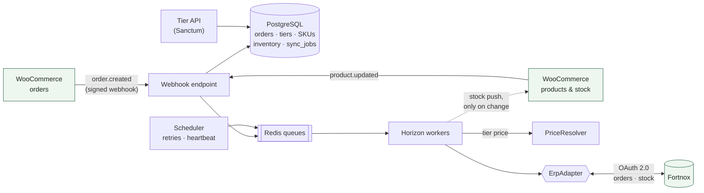
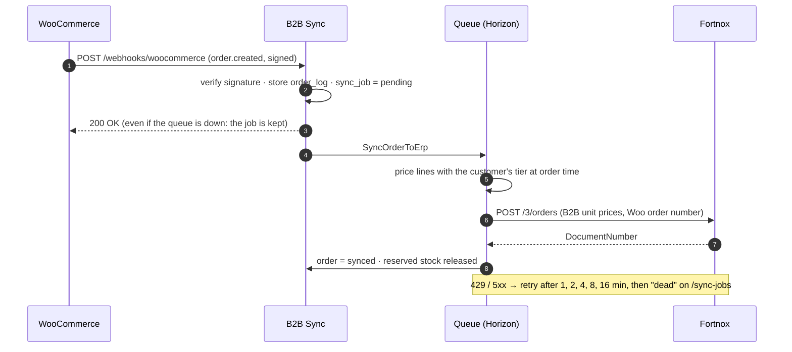

# VerdantCart B2B Sync

[](https://github.com/verdantcart/verdantcart-b2b-sync/actions/workflows/ci.yml)


> WooCommerce ↔ Fortnox middleware for Nordic B2B wholesale brands. Customer-tier pricing, buffered stock and automatic order transfer, so nobody re-types web orders into the ERP.

**Live demo:** <https://verdantcart-b2b-sync.fly.dev> (synthetic data; the demo uses the built-in fake ERP)

---

## The problem

A wholesale brand on WooCommerce sells to shops and cafés, not consumers. Every buyer has negotiated prices, stock is shared with other sales channels, and the books live in Fortnox. In practice that means:

- orders copied from WooCommerce into Fortnox by hand, with typos and delays,
- the shop charging list price while the invoice should use the customer's agreed price,
- big buyers ordering stock that the warehouse has already promised elsewhere.

## What it does

| | |
|---|---|
| **Tier pricing** | Customers belong to price tiers (e.g. *Guld −10 %*, *Partner −18 %*, time-boxed campaigns). Every order line is priced with the tier that was valid when the order was placed, in exact öre (no float rounding). |
| **Order sync** | A signed WooCommerce webhook records the order, a queue worker prices it and creates it in Fortnox with the B2B prices, the Woo order number and the tier used. |
| **Inventory buffering** | Sellable stock = ERP warehouse − open orders − safety buffer, pushed back to WooCommerce only when it changes. Ends the "Woo says 555, the warehouse has 40" problem. |
| **Reliability** | Duplicate webhooks are ignored, retries use exponential backoff, a crash mid-push never creates a second Fortnox order, and failed jobs wait on a page with a *Retry* button. |
| **Tier API** | Token-protected REST API (`/api/tiers`, `/api/customers/{id}/tier`, `/api/customers/{id}/price/{sku}`) for other systems that need the B2B price. |
| **Storefront prices** | `GET /api/woo-customers/{wooId}/prices?skus=A,B,C` returns a logged-in shop customer's prices for up to 100 SKUs in one call, from the same price rules as order sync, so the shop and the Fortnox order always agree. |
| **Price check** | Every order compares what WooCommerce charged with the B2B price. Any difference (for example the shop charged list price while B2B Sync was unreachable) is logged and listed on the dashboard; Fortnox always gets the agreed B2B price. |

## Architecture



An order, end to end:



Adding another ERP (Visma, Business Central …) means one new class implementing `App\Erp\ErpAdapter`; nothing else changes.

## Tech stack

Laravel 13 · PHP 8.3+ · PostgreSQL 16 · Redis 7 + Laravel Horizon · Sanctum · PHPUnit (131 tests, run on SQLite and Postgres in CI) · Docker on Fly.io · Sentry · structured JSON logs

## Running it locally

Requirements: PHP 8.3+ with `pdo_pgsql`, Composer 2, PostgreSQL 16 and Redis 7 (via `docker compose up -d`, or Laragon on Windows).

```bash
git clone https://github.com/verdantcart/verdantcart-b2b-sync.git
cd verdantcart-b2b-sync
composer install
cp .env.example .env
php artisan key:generate

docker compose up -d                 # Postgres 16 + Redis 7
php artisan migrate --seed           # schema + Nordic demo data

php artisan serve                    # dashboard at http://127.0.0.1:8000
php artisan queue:work redis --queue=orders,inventory,default
php artisan schedule:work            # retries + heartbeat
```

On Linux/macOS you can run `php artisan horizon` instead of `queue:work`. Windows lacks the `pcntl` extension Horizon needs, but the dashboard at `/horizon` still works with `queue:work`.

### Connecting a store and an ERP

```bash
# WooCommerce: add WOO_BASE_URL, WOO_CONSUMER_KEY, WOO_CONSUMER_SECRET to .env, then
php artisan woo:ping                 # checks the API key (signs requests automatically on http://)
php artisan woo:webhooks             # registers the webhooks and generates WOO_WEBHOOK_SECRET

# Fortnox: create an integration in Fortnox's Developer Portal
#   redirect URI: http://127.0.0.1:8000/fortnox/callback
#   scopes:       Artikel, Företagsinformation, Kund, Order
# add FORTNOX_CLIENT_ID / FORTNOX_CLIENT_SECRET and ERP_DRIVER=fortnox to .env, open /fortnox/connect, then
php artisan erp:status               # shows the connected company
php artisan erp:pull-customers       # links Fortnox customers by number, org number or e-mail
```

### Useful commands

| Command | What it does |
|---|---|
| `woo:pull-order 24 25` | Fetch orders whose webhook never arrived and process them |
| `inventory:set SKU 40 --buffer=5` | Set warehouse stock and safety buffer, push to Woo |
| `inventory:sync --all` | Re-buffer every linked SKU |
| `sync:dispatch-pending --include-failed` | Re-queue waiting or failed sync work |
| `queue:heartbeat` | Prove a worker is consuming the queue |
| `api:token "Name" --ability=prices:read` | Create a scoped API token |
| `fortnox:seed-sandbox` | Copy the shop's customers and articles into a Fortnox **test** company |

### Alerts

B2B Sync e-mails you when something needs a person:

- an order or stock update **gave up** (all 6 retries used, or a problem retries cannot fix, such as an unknown SKU or a customer not linked to Fortnox);
- the shop **charged a different price** than the B2B price by more than `B2B_PRICE_TOLERANCE` (1.00 by default; smaller differences are rounding).

Each problem is mailed once, at most `B2B_ALERT_MAX_PER_HOUR` mails are sent (20), and a broken mail setup never stops the sync. Set it up in `.env`:

```env
B2B_ALERT_EMAIL=you@example.com        # comma-separate several addresses
MAIL_MAILER=smtp                        # plus MAIL_HOST, MAIL_PORT, MAIL_USERNAME, MAIL_PASSWORD
MAIL_FROM_ADDRESS=b2b-sync@example.com
```

Then check it with `php artisan alerts:test`. Mails are sent by the queue worker (Horizon).

## Tests

```bash
php artisan test                     # SQLite in memory, never touches a real ERP or store
```

CI runs Pint plus the full suite on PHP 8.3 and 8.4, and once more against PostgreSQL 16.

## Deploying

`fly.toml` and `Dockerfile` run the whole app in one 512 MB machine (nginx + php-fpm, Horizon, scheduler, Redis). Secrets: `APP_KEY`, `DB_URL` (e.g. a Neon connection string), `SENTRY_LARAVEL_DSN`, `HORIZON_BASIC_AUTH_PASSWORD`. Migrations run on every deploy.

```bash
fly apps create <name>
fly secrets set "APP_KEY=…" "DB_URL=…" "HORIZON_BASIC_AUTH_PASSWORD=…"
fly deploy
```

## Adopting it for your store

VerdantCart B2B Sync is MIT-licensed: you can run it yourself. Most brands prefer it set up for them:

1. **Discovery (1 call):** your tiers, price agreements, Fortnox setup and order volume.
2. **Setup (1–2 weeks):** connect your store and Fortnox, import customers and tiers, set buffers, test against a Fortnox sandbox with real orders.
3. **Go-live and support:** monitoring, error alerts and changes as your price lists evolve.

Interested? **support@verdantcart.ai**

## Status

v0.1, built in a 15-day sprint (Oct–Nov 2026). Planned next: price lists per SKU (fixed prices on top of tier discounts), Fortnox customer creation from Woo, more ERP adapters.

## License

[MIT](LICENSE). Use it, fork it, ship it.

## Part of the VerdantCart product family

- **VerdantCart Carbon Reports**: free WooCommerce carbon reporting plugin (wp.org)
- **VerdantCart Pro**: audit-ready carbon reports and /carbon.txt publishing
- **VerdantCart B2B Sync**: this project

<https://verdantcart.ai>
